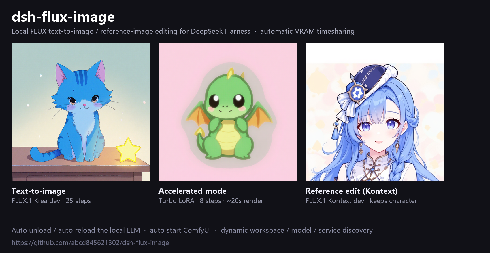

# dsh-flux-image


[](https://github.com/abcd845621302/dsh-flux-image/actions/workflows/ci.yml)
[](CONTRIBUTING.md)

给 **[DeepSeek Harness](https://github.com/deepseek-ai)**（DSH）添加本地 FLUX 文生图 / 参考图编辑能力，并在本地大模型与 ComfyUI 之间**自动分时复用显存**。

[English](README.md) | [MIT 许可证](LICENSE) | [贡献指南](CONTRIBUTING.md)



---

## 简介

`dsh-flux-image` 在 DSH 中注册一个 `generate_image` 工具，通过本地 **ComfyUI** 驱动 **FLUX.1** 模型出图。出图前自动卸载占显存的本地大模型（如 Strata 上的 Qwen），出图后由**插件进程**自动重载（图片先返回，模型在后台恢复）。

适用于「本地大模型与图像模型无法同时驻留显存」的机器——例如 12GB 显卡上运行 75GB MoE 大模型 + 12B FLUX 模型。

所有处理都在**本地**完成：无云端 API、无遥测，数据不出本机。

## 功能特性

| 功能 | 说明 |
|---|---|
| **文生图** | FLUX.1 Krea dev（ComfyUI，默认 25 步） |
| **参考图编辑** | FLUX.1 Kontext dev（GGUF / safetensors 均可），保持角色一致性 |
| **加速模式** | FLUX Turbo / Lightning LoRA，8 步采样（约为常规耗时的 20%，画质略有损失） |
| **显存分时** | 自动卸载已加载的本地大模型（`POST /v1/unload`），出图后由**插件进程**重载（`POST /v1/load`），图片先返回 |
| **全动态探测** | 工作区、ComfyUI 目录/端口、模型文件、本地模型服务地址全部自动识别，环境变量可覆盖 |
| **自动界面** | 首次出图自动打开 ComfyUI 页面（窗口标题检测 + 20 分钟节流）；出图结束自动关闭本次启动的 ComfyUI 释放显存 |
| **干净收尾** | 不残留 ComfyUI 进程；可选显示 ComfyUI 控制台窗口查看加载/采样日志 |

## 工作原理

```
模型调用: generate_image(prompt, image?, accelerate?, size?, steps?, seed?)
        │
        ▼
  flux-image-plugin/dsh/index.js  （DSH 薄封装）
        │  spawn `py gen.py ...`
        ▼
  gen.py
    1. 探测 DSH 工作区（DSH_WORKSPACE → workspace.json + DSH_SESSION_ID → 默认工作区 → cwd）
    2. 探测 ComfyUI 安装目录/端口，扫描模型（Kontext / Krea / CLIP / VAE / LoRA）
    3. 探测本地大模型服务（STRATA_URL / local_models.json / 常见端口，校验 service=strata）
    4. 若本地大模型已加载 → POST /v1/unload 腾显存
    5. ComfyUI 未运行则启动（可写目录重定向到工作区）
    6. 提交工作流、轮询 /history、下载 PNG 到 <工作区>/flux_images/
    7. /free 释放 ComfyUI → 关闭本次自动启动的 ComfyUI
    8. 插件（index.js）启动 reload_strata.py 执行 POST /v1/load —— 图片先返回，模型在后台恢复
        │
        ▼
  返回图片的绝对路径
```

## 环境要求

| 依赖 | 说明 |
|---|---|
| **操作系统** | **Windows 10/11** —— `gen.py` 使用了 `taskkill`、`CREATE_NEW_CONSOLE` 和 Windows 窗口检测 API |
| **Python 3** | 默认用 `py` 启动，可用 `FLUX_IMAGE_PY` 覆盖 |
| **ComfyUI** | Windows 便携版（含 `ComfyUI/main.py` 与 `python_embeded/python.exe`） |
| **FLUX 模型** | 放在 ComfyUI 的 `models/diffusion_models`：Krea（文生图）和/或 Kontext（参考图） |
| **文本编码器 / VAE** | `clip_l`、`t5xxl`、`ae.safetensors`（标准 FLUX ComfyUI 配置） |
| **加速 LoRA**（可选） | `models/loras` 中名称含 `turbo` 或 `lightning` 的文件 |
| **DeepSeek Harness** | dsh 桌面版 / CLI |

### 模型许可提示

FLUX.1 系列模型使用各自的许可证（FLUX.1 [dev] / [kontext] dev 为**非商用**许可）。本项目只负责调度 ComfyUI，**你需要自行遵守所使用模型的许可证**。

## 安装

1. 把 `gen.py`、`local_models.json`、`flux_dev_fp8_api.json`、`flux_kontext_gguf_api.json` 和
   `flux-image-plugin/` 放在同一个插件目录（例如 `D:/ComfyUI-Plugin`，路径随意）。
   插件会通过 `FLUX_IMAGE_PLUGIN_DIR` 环境变量、再按安装包的父目录顺序寻找 `gen.py` ——
   因此要么设置 `FLUX_IMAGE_PLUGIN_DIR`，要么把这四个文件复制到插件包旁边。
2. 把 `flux-image-plugin/` 安装进 DSH，两种方式任选：
   - 使用 DSH 内置插件管理器：
     ```
     plugin_manager(action: "install_bundle", target: "<path>/flux-image-plugin")
     ```
   - 或复制到 `~/.dsh/profiles/<profile>/node_modules/dsh-flux-image` 后重启 DSH。
3. 改动 `index.js` 后需要重启 DSH；`gen.py` / 工作流 JSON 的改动每次调用自动生效。

## 使用

```json
generate_image(prompt, image?, accelerate?, size?, steps?, seed?)
```

| 参数 | 说明 |
|---|---|
| `prompt` | 图像描述（FLUX 建议使用详细英文提示词） |
| `image` | 可选，参考图路径 → 走 Kontext 参考图工作流 |
| `accelerate` | 可选，`true` → 加载加速 LoRA、8 步采样 |
| `size` | 文生图尺寸，默认 `1024x1024` |
| `steps` | 采样步数（默认：文生图 25 / 加速 8 / Kontext 20） |
| `seed` | 可选随机种子 |

生成的图片保存到 `<DSH 工作区>/flux_images/`。

### 示例

```
# 文生图
generate_image(prompt="a cute blue cat on a desk, anime style, soft background")

# 加速模式（8 步）
generate_image(prompt="a cute anime girl icon, blue hair, hanfu", accelerate=true)

# 参考图编辑（Kontext）
generate_image(image="D:/refs/character.jpg",
               prompt="turn the reference into a clean app icon, keep the hair and outfit, no text")
```

## 配置

### 动态探测顺序

| 项目 | 顺序 |
|---|---|
| 工作区 | `DSH_WORKSPACE` → `$DSH_HOME/storages/workspace.json`（按 `DSH_SESSION_ID` 匹配）→ 默认工作区 → cwd |
| ComfyUI 目录 | `COMFYUI_DIR` → 常见安装路径（`D:\Flux\comfyui\ComfyUI_windows_portable` 等） |
| ComfyUI 端口 | `COMFYUI_PORT`（默认 `8188`） |
| 模型 | 扫描 `models/diffusion_models`（kontext/krea）、`models/text_encoders`（clip_l/t5xxl）、`models/vae`、`models/loras`（turbo/lightning） |
| 本地模型服务 | `STRATA_URL` / `STRATA_PORT` → `local_models.json` → 常见端口扫描（校验 `"service": "strata"`） |
| 可写目录 | `<工作区>/flux_comfy/{input,output,temp,user}` |

### 环境变量

| 变量 | 作用 |
|---|---|
| `FLUX_IMAGE_PY` | Python 启动命令（默认 `py`） |
| `FLUX_IMAGE_PLUGIN_DIR` | 插件目录（安装副本与源目录分离时使用） |
| `COMFYUI_DIR` | ComfyUI 安装目录 |
| `COMFYUI_PORT` | ComfyUI 端口（默认 `8188`） |
| `STRATA_URL` / `STRATA_PORT` | 本地大模型服务地址 / 端口 |
| `FLUX_OPEN_UI` | 设为 `1` 强制每次出图都打开 ComfyUI 页面 |

### `local_models.json`

列出参与显存分时的本地大模型服务：

```json
{
  "services": [
    {
      "name": "qian-wen",
      "health": { "url": "http://127.0.0.1:8085/health", "loaded_field": "loaded" },
      "unload": { "url": "http://127.0.0.1:8085/v1/unload", "body": {} },
      "load":   { "url": "http://127.0.0.1:8085/v1/load",   "body": {} }
    }
  ]
}
```

ComfyUI 本身**故意不**放在这里——它由 `gen.py` 负责管理。

## 仓库结构

```
.
├── gen.py                         # 出图主脚本：探测 + 分时 + ComfyUI 调用
├── local_models.json              # 本地大模型服务清单（health / unload / load）
├── flux_dev_fp8_api.json          # 文生图工作流（ComfyUI API 格式）
├── flux_kontext_gguf_api.json     # Kontext 参考图工作流（ComfyUI API 格式）
├── README.md                      # 英文文档
├── README.zh-CN.md                # 中文文档
├── LICENSE                        # MIT
└── flux-image-plugin/             # DSH 插件包
    ├── package.json
    ├── cordis.patch.yml
    └── dsh/
        ├── index.js               # 注册 generate_image 工具
        └── spawnHidden.js         # 无窗口 spawn（Windows）
```

## 常见问题

| 现象 | 处理方法 |
|---|---|
| `ComfyUI 启动超时` / 连接失败 | 检查 `COMFYUI_DIR`，确认 `python_embeded\python.exe` 存在 |
| HTTP 400 `prompt_outputs_failed_validation` | 工作流引用的模型不在 ComfyUI `models/` 中——检查模型文件 |
| 出图后本地模型一直未加载 | 插件触发的重载失败；检查 `reload_strata.py` 是否可运行，或手动 `POST http://127.0.0.1:8085/v1/load` |
| 浏览器页面打开太频繁 | 每 20 分钟最多自动打开一次，且检测到已有 ComfyUI 页面时跳过；可用 `FLUX_OPEN_UI` 强制 |
| 看不到控制台窗口 | ComfyUI 控制台窗口每轮出图出现一次，出图结束随进程关闭 |

## 免责声明

本项目与 DeepSeek、Black Forest Labs、ComfyUI、阿里巴巴及任何模型提供方**无隶属、背书或赞助关系**，是一个独立集成工具，仅负责调度本地软件。

- **无担保。** 本软件按「原样」提供，不附带任何明示或暗示的担保，包括但不限于适销性、特定用途适用性和不侵权担保。作者不对因使用本软件而产生的任何索赔、损害或其它责任负责。
- **生成内容的合规责任由使用者承担**：你需要遵守所使用模型/工具各自的许可证与可接受使用政策（包括 FLUX 的非商用许可），以及所在地区的法律法规。
- **本地与隐私。** 工具完全在本机运行，不会把提示词、参考图或生成图片上传到任何服务器；只有你配置的 DSH agent 能看到生成结果的文件路径。
- **凭据。** 请勿把 API token 或凭据提交到本仓库；`.gitignore` 已排除常见敏感文件，建议使用短期令牌并在用完后吊销。

## 贡献

欢迎提交 Issue 和 Pull Request。请保持改动聚焦，在真实 ComfyUI + DSH 环境中测试，并说明测试环境。

## 许可证

[MIT](LICENSE)
